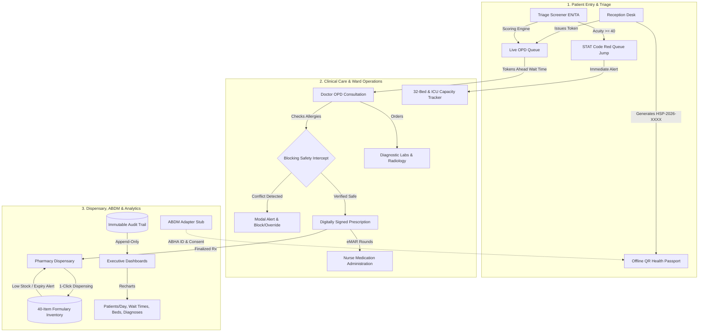

# Hospital Smart Management System (HSMS)
### by Team MediTechTitans • Connected Healthcare Platform

> [!CAUTION]
> **DISCLAIMER: Demo system. Not for real clinical use.** This software is an advanced competition and educational demonstration prototype developed by Team MediTechTitans.

---

## 🏥 Architecture Overview

HSMS is a unified digital healthcare management web application built to eliminate outpatient delays, lost medical records, language barriers, and inventory stock discrepancies through a single, 7-role platform.



---

## 🎨 Design System & Color Palette
In strict adherence to project specifications:
- **Background**: Crisp White (`#FFFFFF`)
- **Headings & Primary Actions**: Vivid Red (`#FF0000`)
- **Body Text & Links**: Deep Blue (`#0000CC`)
- **Highlights, Badges & Tags**: Energetic Orange (`#E36C09`)
- **Typography**: Clean, large, tablet-first readable typography with accessibility contrast.

---

## 👥 7-Role Permission Matrix & Demo Accounts

| Role | Demo Account Name | Key Permissions & Guardrails |
|---|---|---|
| **Patient** | `Thirunavukkarasu Muthukumar` | Views offline QR passport, tracks live token wait time, listens to Tamil voice prescription |
| **Reception** | `Deepa Krishnan` | Registers new patients, generates unique IDs (`HSP-2026-XXXX`), issues OPD tokens |
| **Triage Staff** | `Sister Mary Joseph (Triage RN)` | Conducts multilingual symptom screening (English & Tamil), evaluates acuity, triggers Code Red queue jumps |
| **Doctor** | `Dr. Carlo Toledano, MD` | Reviews medical history timeline, orders labs, authors digital prescriptions with blocking allergy warning |
| **Nurse** | `Nurse Geetha R., RN` | Administers scheduled doses with badge ID and timestamps, documents reasons for delays/omissions |
| **Pharmacist** | `R. Anand, B.Pharm` | 1-click dispensing against finalized prescriptions, atomic stock decrement, low-stock/expiry monitoring |
| **Admin** | `Dr. R. Natarajan` | Executive Recharts dashboards (patients/day, wait times, 32 beds, top diagnoses, inventory), user RBAC toggling, audit logs |

---

## ⚡ Setup & Local Development

### 1. Prerequisites
- **Node.js**: v18.0.0 or higher
- **npm**: v9+
- *(Optional)* Firebase CLI: `npm install -g firebase-tools` (for local emulator suite)

### 2. Installation
```bash
# Clone or navigate to the project directory
cd "hospital management system"

# Install dependencies (includes React 19, Tailwind v4, Zod, Recharts, Firebase)
npm install
```

### 3. Launch Development Server
```bash
npm run dev
```
Open **[http://localhost:5173](http://localhost:5173)** in your browser.

### 4. Running with Firebase Emulator (Zero Real Credentials Needed)
```bash
# In a separate terminal, launch the Firebase emulator suite:
firebase emulators:start --only firestore,auth
```
- The application automatically connects to local Firestore on `localhost:8080` and Auth on `localhost:9099`.
- If emulators are not running, HSMS seamlessly uses the built-in synthetic local database.

### 5. Running the Test Suite
```bash
npm test
```
All **35 Vitest tests pass** with 0 errors across schemas, allergy checks, wait-time calculations, triage scoring, RBAC guards, inventory logic, QR payload, and ABDM adapter.

### 6. Production Build
```bash
npm run build
npm run preview
```

---

## 🎬 End-to-End Walkthrough Demo Script
Follow this 6-step script to experience the connected clinical workflow:

1. **Step 1 — Registration (Reception Desk)**:
   - Click **"Reception Desk"** in the sidebar.
   - Enter patient details: `Kavitha Balakrishnan`, 38F, Blood Group `B-`, Allergies `Penicillin, Sulfa`, Mobile `+91 94441 55667`.
   - Click **"Complete Registration & Issue Offline QR Passport"**.
   - Notice the unique ID generated (`HSP-2026-XXXX`) and the offline vector QR code encoding blood group and allergies.

2. **Step 2 — Triage & Code Red (Triage Staff)**:
   - Click **"Triage & Screener"** in the sidebar.
   - Select patient `Muthuvel Pandian`. Toggle to **"தமிழ் (Tamil)"** and enter: `"நெஞ்சு வலி மற்றும் இடது கை வலி, அதிக வியர்வை"`.
   - Click **"Evaluate Triage Acuity Score"** ➔ Score triggers **Critical (Red)**.
   - Click **"Escalate to Emergency Code Red & Jump Queue"** ➔ Code Red banner triggers hospital-wide and patient jumps the queue.

3. **Step 3 — Doctor Consultation & Allergy Warning (Doctor OPD)**:
   - Click **"Doctor OPD"** in the sidebar.
   - Select patient `Muthuvel Pandian` (Allergic to Penicillin).
   - In Prescribed Medications, select **"Amoxicillin + Clavulanate (Augmentin 625)"** from the quick-add dropdown.
   - **Notice the Blocking Modal**: The system halts the action, warning that Augmentin is a penicillin-class antibiotic contraindicated for this patient.
   - Select a safe alternative (e.g. `Azithromycin 500mg` or `Paracetamol`) and click **"Digitally Sign & Lock Electronic Prescription"**.

4. **Step 4 — Patient Voice Prescription (Patient Portal)**:
   - Switch to **"Patient Portal"** in the sidebar.
   - Click the **"Tamil Voice Prescriptions"** tab.
   - Adjust the speed slider (e.g. `0.85x` for elderly clarity).
   - Click the big red **Play Button** to hear instructions read in Tamil via the Web Speech API (`ta-IN`), or view the full Tamil transcript fallback.

5. **Step 5 — 32-Bed Grid & Transfer (Ward & ICU)**:
   - Click **"Ward & ICU Beds"** in the sidebar.
   - Observe the 32 beds (8 ICU, 6 Emergency, 12 General Ward, 6 Pediatric) color-coded by status.
   - Click on occupied bed `GW-01` (`Shanthi Venkatesh`).
   - Click **"Transfer Patient to Another Bed"**, choose available bed `GW-03`, and click **"Confirm Transfer"**.
   - `GW-01` automatically enters the UV sterilization queue while `GW-03` becomes occupied.

6. **Step 6 — Pharmacy Dispensing (Pharmacy Dispensary)**:
   - Click **"Pharmacy Dispensary"** in the sidebar.
   - In the Prescription Queue, find the finalized order and click **"Dispense Medicines & Deduct Stock Atomically"**.
   - Switch to **"Formulary Inventory"** to verify stock levels have decremented in real time.

7. **Step 7 — Executive Analytics (Admin Analytics)**:
   - Click **"Admin Analytics"** to view Recharts dashboards for daily patient volumes, departmental wait times, bed occupancy distribution, top diagnoses, and the searchable audit log with CSV export.

8. **Step 8 — Universal Aadhaar Lifetime Health Record Vault (ஆதார் கார்டு தேடல்)**:
   - Click the **"🔍 ஆதார் கார்டு தேடல்"** button in the top navigation bar or sidebar.
   - Enter any 12-digit Aadhaar UID (or click on one of the quick demo patients, e.g. `Muthuvel Pandian` - `4511 8821 1001`).
   - Instantly view the patient's complete cross-hospital electronic health record aggregated across Tamil Nadu and India:
     - **All Diagnostic Test Reports**: Complete Blood Count (CBC), Cardiac 12-Lead ECG, Digital Chest X-Ray, Glycated Hemoglobin (HbA1c) from Apollo, GH Chennai, Kauvery, MediTech, and MMM.
     - **Past Tablets & Prescriptions**: Dosages, frequencies, indications, prescribing doctors and hospitals (Metformin, Telmisartan, Atorvastatin, Augmentin).
     - **Surgical Operations**: Procedures, implant details (titanium plates, drug-eluting stents, titanium clips), operating surgeons, and dates.
     - **Cross-Hospital Encounters**: Complete timeline across inpatient admissions, daycare surgeries, and outpatient consultations.
   - Click **"Print Lifetime Record"** for an official hospital consolidated summary report.

---

## 🧩 Architectural Stubs & Extensibility Points

| Module | Current State | Production Path |
|---|---|---|
| **ABDM / ABHA** | `src/lib/abdmAdapter.js` provides stub methods for `generateABHA`, `verifyABHA`, `linkCareContext`, and consent requests. | Swap stub responses with National Health Authority (NHA) gateway endpoints using client certificates. |
| **Tamil Voice API** | Native Web Speech API (`SpeechSynthesisUtterance`) with Tamil voice `ta-IN` lookup and full Tamil transcript fallback. | Integrates with cloud TTS APIs (e.g., Google Cloud Text-to-Speech) if custom synthetic voices are required. |
| **AI Symptom Screener** | Deterministic clinical rule-engine evaluating red-flag symptom lexicons in English and Tamil. | Clean adapter interface ready to pipe symptom input into medical LLMs (e.g. Med-PaLM / Gemini Health). |
| **Firebase Cloud vs Local** | Dual-mode operation: connects to Firebase Cloud / Emulator if configured in `.env`, otherwise runs locally with zero config. | Populate `.env` with production Firestore & Firebase Auth credentials and deploy security rules. |

---

Developed with ❤️ for healthcare accessibility by **Team MediTechTitans**.
# hospital-management-system-

